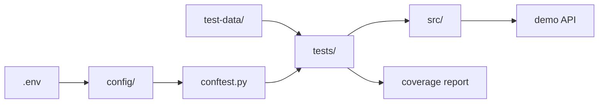

# pytest-python-test-automation

A small Python API + unit test project built with pytest and requests.
The API tests run against the public JSONPlaceholder fake API
(https://jsonplaceholder.typicode.com). It does not store anything, so
POST/PUT/PATCH/DELETE return simulated responses, not real saved data.

## Folder tree

```text
pytest-python-test-automation/
├── .env.example          # Safe default env keys (copy to .env)
├── ARCHITECTURE.md       # Folder purposes, data flow, how to add a test
├── conftest.py           # Fixtures: config + test-data wired into tests
├── pytest.ini            # testpaths, markers (api, unit, utils), coverage threshold 90%
├── requirements.txt      # pytest, requests, pytest-html, pytest-cov, allure-pytest
├── config/               # settings.py: base URL + timeout from env vars
├── docs/                 # SETUP.md, TESTING.md
├── src/                  # utils.py + ui_helper.py: pure helpers under test, no network
├── test-data/            # posts.json, users.json, utils.json, ui.json, negative.json
└── tests/                # test_api.py (9 API), test_api_negative.py (15 negative/schema),
                          # test_utils.py (21 unit), test_ui_helper.py (13 utils)
```

See `ARCHITECTURE.md` for why each folder exists and how
config, test-data, `src/`, and `tests/` connect.

## What is covered

- `tests/test_api.py` (9 tests): GET /posts list and fields, GET /posts/1,
  POST /posts, PUT /posts/1, PATCH /posts/1, DELETE /posts/1, GET /users,
  and negative cases (GET /posts/999999 and GET /invalid, both 404).
- `tests/test_api_negative.py` (15 tests, marker `api`): API negative
  and schema tests with Allure steps and `@allure.feature` /
  `@allure.story` markers: invalid ids (missing user, non-numeric
  post/user id, PUT to a missing post, all 404), create with missing
  required fields (the fake API still returns 201 and omits the
  missing fields), wrong HTTP method (POST to `/posts/1`, PUT/PATCH/
  DELETE on the `/posts` collection, all 404), and response-schema
  validation for every post and user (required fields, field types,
  nested `address`/`company`/`geo`, valid email). Cases live in
  `test-data/negative.json`.
- `tests/test_utils.py` (21 tests): unit tests for the helpers in
  `src/utils.py`: `build_post_payload`, `is_valid_email`, `format_user_name`.
  All cases are loaded from `test-data/utils.json`.
- `tests/test_ui_helper.py` (13 tests): unit tests for the UI helpers
  in `src/ui_helper.py`: `format_post_title`, `truncate_text`,
  `render_post_summary`, `build_user_badge`. All cases are loaded
  from `test-data/ui.json`.
- `src/utils.py` and `src/ui_helper.py`: the helpers themselves, no
  network calls.
- `config/settings.py`: base URL and timeout from env vars
  (`API_BASE_URL`, `REQUEST_TIMEOUT`); the only place a URL or
  timeout default lives. `conftest.py` imports it and builds the
  `base_url` / `api_session` fixtures from it.
- `test-data/`: payloads, endpoints, expected status codes, ids,
  and unit-test cases as JSON, loaded by the tests. No URL,
  timeout, credential, or expected value is hard-coded in a test.

## Install

```bash
python3 -m venv .venv
source .venv/bin/activate
pip install -r requirements.txt
```

Optional configuration (defaults work out of the box):

```bash
cp .env.example .env   # edit API_BASE_URL / REQUEST_TIMEOUT if needed
```

Full setup guide: `docs/SETUP.md`.

## Run

```bash
python -m pytest
```

Run only the API tests, only the unit tests, or only the utils tests:

```bash
python -m pytest -m api
python -m pytest -m unit
python -m pytest -m utils
```

HTML report:

```bash
python -m pytest --html=report.html --self-contained-html
```

Allure report (needs the Allure commandline installed separately):

```bash
python -m pytest --alluredir=allure-results
allure serve allure-results
```

Coverage of `src/` runs on every run (see `pytest.ini`, fail-under 90%):

```bash
python -m pytest --cov-report=html
```

Full testing guide: `docs/TESTING.md`.

## Result observed

Ran `.venv/bin/python -m pytest -q` on 2026-11-20 with Python 3.12.3 and
pytest 9.2.0: **30 passed in 2.26s** (9 API tests, 21 unit tests),
live against JSONPlaceholder. Coverage of `src/`: 100%.

The UI helper tests (13 tests, `tests/test_ui_helper.py`) were added
after that run and have not been run yet; the suite is 43 tests on
paper until it is run again.

The negative/schema tests (15 tests, `tests/test_api_negative.py`)
were added after that run as well and have not been run yet; the
suite is 58 tests on paper until it is run again.

The previous run on 2026-11-18 was 29 passed in 2.28s; the count
rose by 1 because the blank-name fallback case in `format_user_name`
is now two separate parametrized cases (empty string and
whitespace-only) instead of one test with two asserts.
No test logic changed.

## Diagram


